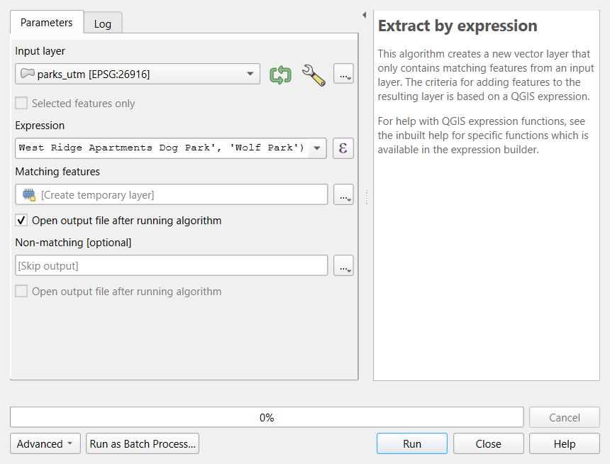
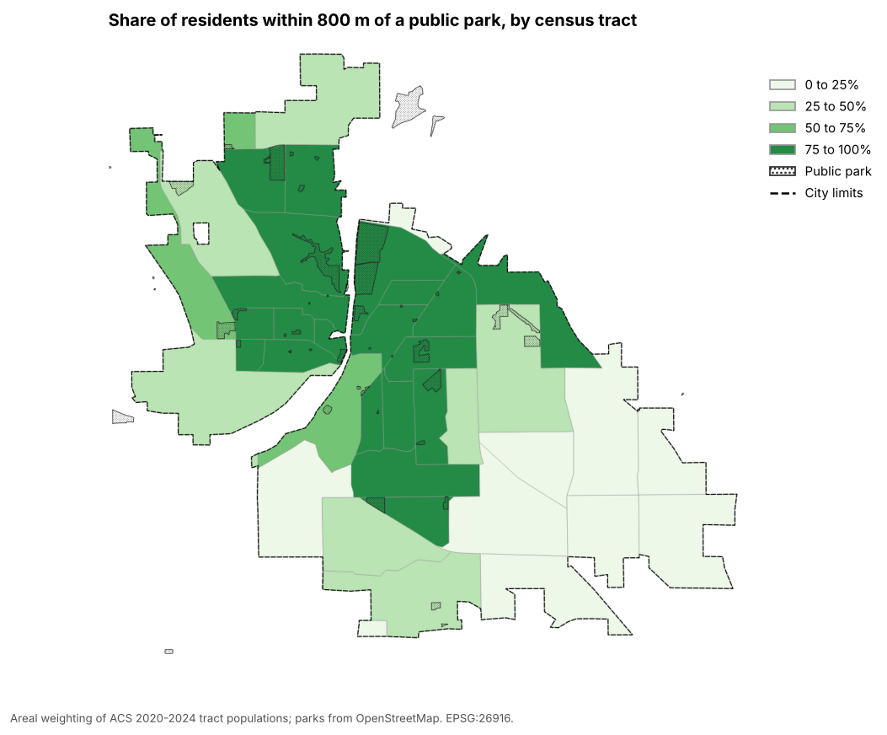

:::::::::::::::::::::::::::::::::::::: questions

- What share of residents, children and car-free households can walk to a public park in Lafayette and West
  Lafayette?
- Which neighborhoods have the least access?
- How much do the analyst's decisions change the answer?

::::::::::::::::::::::::::::::::::::::::::::::::

::::::::::::::::::::::::::::::::::::: objectives

- Turn a policy standard (the 10-minute walk) into a measurable definition of access
- Select the features that count as parks with an expression, and document the decision
- Estimate access for several population groups with Buffer, Clip, Intersection and the Field Calculator
- Join results back to tracts, map them, and test the decisions

::::::::::::::::::::::::::::::::::::::::::::::::

## Why parks, and why walking distance?

Parks are linked to physical activity, mental health, cooler neighborhoods in heat waves and social contact. What
matters for everyday use is **proximity**: many park visits, especially by children and older adults, are on foot, and
households without a car cannot easily reach a park across town. Many cities therefore adopt a **10-minute walk**
standard: every resident within about a half mile (**800 m**) of a park, the benchmark used by the Trust for
Public Land's ParkScore and by city park plans.

This case study asks, for Lafayette and West Lafayette, Indiana:

1. What share of residents lives within 800 m of a public park?
2. Are **children** and **households without a car** as well served as everyone else?
3. Which neighborhoods have the least access?

It is an **intermediate** case study: it uses only the tools of the Geoprocessing episodes (buffer, dissolve,
clip, intersect, areal weighting) and the Foundations episodes on tables and joins. The new work is in the
**decisions**, and in showing how much the answer depends on them.

## Decisions that shape the answer

| Decision | Choice here | Alternatives |
|---|---|---|
| What counts as a park | OpenStreetMap features tagged `leisure=park`, **minus** 13 that are not public recreational parks: campus malls and plazas, intramural fields, a scout camp, a shrine, an apartment dog park and Wolf Park (admission) | All OSM parks; the cities' official park lists; only parks over a minimum size |
| How far is close | **800 m** straight line from the park **edge** | 400 m (5 minutes); network distance along walkable streets; distance to entrances |
| Where people live | Census tracts, with **areal weighting** inside each tract | Block groups or blocks; dasymetric estimation with land cover |
| Who counts | Residents, children (under 18), households without a car | Older adults, low-income households |

Every row is a judgment call. Write each one down with its reason, and test the ones that might change the
answer (a **sensitivity analysis**).

## What the analysis finds

- About **71%** of residents in the two cities live within 800 m of a public park, but only about **63%** of
  **children**, while **78%** of households without a car do.
- Access is lowest in **Census Tracts 17.01 (east-central Lafayette) and 15.01 (southwest Lafayette)**, home to
  more than 8,000 people with median incomes well below the county's typical level, where almost no one lives
  within 800 m of a public park.
- Across income thirds there is **no simple gradient** (about 67%, 72% and 64% from lowest to highest income).
- Dropping the 13 non-park features barely changes the result, but the **distance** does: at 400 m only about
  41% of residents and 34% of children are served.

## Limitations

- **Straight lines** ignore barriers: the Wabash River, railroads and highways. Network distance (Data Analysis
  module, Network Analysis; Case Studies, Grocery Access Part 2) is more realistic.
- **Edges, not entrances**, and **all parks count the same**, whatever their size or facilities.
- **Areal weighting** spreads people evenly within tracts.
- **OpenStreetMap completeness**: a park missing from OSM looks like a gap in access. Check low-access tracts
  against official park lists, imagery or a site visit before recommending anything.

---

## Hands-on

These steps were checked in QGIS 4.0. They use the tools of the Data Processing module's
[Geoprocessing in QGIS](https://spatialturn.github.io/DataProcessing/geoprocessing-qgis.html) episode and the
Foundations module's [Tables, Joins and Selections](https://spatialturn.github.io/Foundations/qgis-tables.html)
episode; look back there if a step is unfamiliar. The [Python version](park-access-python.md) of this case study
reaches the same numbers.

::::::::::::::::::::::::::::::::::::: callout

### If QGIS asks you to choose a transformation

When layers in latitude and longitude (EPSG:4326) are drawn in a project in UTM (EPSG:26916), QGIS may open a
window that begins "Multiple operations are possible for converting coordinates". For this county any of the
options is accurate to a few meters: keep the first (highlighted) one and click **OK**.

::::::::::::::::::::::::::::::::::::::::::::::::

### Part 1: Load and reproject

1. New project, CRS **EPSG:26916**. Load with **Add Vector Layer**, **Protocol: HTTP(S)**, **Type:
   HTTP/HTTPS/FTP**:
   - `https://raw.githubusercontent.com/SpatialTurn/Foundations/main/data/tippecanoe_parks.geojson`
   - `https://raw.githubusercontent.com/SpatialTurn/Foundations/main/data/tippecanoe_tracts_acs.geojson`
   - `https://raw.githubusercontent.com/SpatialTurn/CaseStudies/main/data/study_area.geojson`
2. Reproject all three to EPSG:26916 (**Vector > Data Management Tools > Reproject Layer**) and name them
   `parks_utm`, `tracts_utm` and `city_utm`.

**Check:** 68 parks, 43 tracts, 1 city polygon, all in EPSG:26916.

### Part 2: Keep the public parks

1. Open the attribute table of `parks_utm` and read the names. Which are not public recreational parks?
2. Processing Toolbox: **Extract by expression**, input `parks_utm`, expression:

   ```
   NOT "name" IN ('Bell Tower Area', 'Centennial Mall', 'Centennial Mall South',
     'Memorial Mall', 'Purdue Mall', 'Stadium Mall', 'De Bedout Plaza', 'Spitzer Court',
     'Purdue Gold Intramural Fields', 'Cary Camp, Sagamore Council, BSA',
     'Our Lady of Lourdes Shrine', 'West Ridge Apartments Dog Park', 'Wolf Park')
   ```

3. Name the result `public_parks`.

{alt="Screenshot of the QGIS Extract by expression tool. Input layer is parks_utm in EPSG:26916. The expression box reads NOT name IN followed by a list of thirteen names in single quotes: Bell Tower Area, Centennial Mall, Centennial Mall South, Memorial Mall, Purdue Mall, Stadium Mall, De Bedout Plaza, Spitzer Court, Purdue Gold Intramural Fields, Cary Camp Sagamore Council BSA, Our Lady of Lourdes Shrine, West Ridge Apartments Dog Park and Wolf Park."}

**Check:** `public_parks` has **55** features. The expression is your documented decision: save it in your
project notes.

### Part 3: The 10-minute walk zone

**Vector > Geoprocessing Tools > Buffer**: input `public_parks`, distance **800** meters, segments 16, tick
**Dissolve result**. Name it `walk_zone`.

### Part 4: Residents, children and car-free households in the cities

1. On `tracts_utm`, add the field `tract_m2` = `area($geometry)` (Field Calculator).
2. **Clip** `tracts_utm` to `city_utm` and name it `tracts_city`.
3. In `tracts_city`, add three decimal fields:
   - `pop_city` = `area($geometry) / "tract_m2" * "total_pop"`
   - `kids_city` = `area($geometry) / "tract_m2" * "pop_under18"`
   - `nocar_city` = `area($geometry) / "tract_m2" * "hh_no_vehicle"`
4. **Intersection** of `tracts_city` with `walk_zone`; name it `near_pieces`. Add `pop_near`, `kids_near` and
   `nocar_near` with the same three expressions.
5. With the **Statistics** panel, sum each field and divide: for example the sum of `pop_near` divided by the sum
   of `pop_city`.

**Check:** about **71%** of residents, **63%** of children and **78%** of households without a car are within
800 m of a public park.

### Part 5: Access by tract

1. Because the walk zone was dissolved into one feature, `near_pieces` has at most one piece per tract. Join it
   back: Processing Toolbox, **Join attributes by field value**, input `tracts_city`, field `GEOID`, input 2
   `near_pieces`, field `GEOID`, fields to copy `pop_near`, join type **Take attributes of the first matching
   feature only**. Name it `access`.
2. Add `access_pct` = `coalesce("pop_near", 0) / "pop_city" * 100`. `coalesce()` turns the missing values of tracts
   with no piece in the zone into 0.
3. Style `access_pct` with **Graduated**, manual classes 0 to 25, 25 to 50, 50 to 75 and 75 to 100, a green ramp;
   draw `public_parks` on top with a dotted fill and the city limits as a dashed line.
4. Sort the attribute table of `access` by `access_pct`.

{alt="Map of Lafayette and West Lafayette tracts shaded in four greens by the share of residents within 800 meters of a public park, with public parks drawn with a dotted pattern and the city limits dashed. Central tracts on both sides of the river are darkest (75 to 100 percent). The palest tracts (0 to 25 percent) are on the southeast and south sides of Lafayette and on the eastern edge; several outer tracts in West Lafayette and southern Lafayette are in the 25 to 50 percent class."}

**Check:** Census Tract 17.01 has 0% and 15.01 about 4%.

### Part 6: Test the decisions

1. Rerun Parts 3 and 4 with **400 m**: about 41% of residents and 34% of children.
2. Rerun them with all 68 parks (skip Part 2): about 71.5% of residents, almost unchanged.

The **Graphical Modeler** (**Processing > Graphical Modeler**) can chain Parts 2 to 4 into one tool with the
distance as an input, so a sensitivity analysis becomes one click per scenario.

---

:::::::::::::::::::::::::::::::::::: challenge

## Challenge 1: Which decision matters most?

Look at the sensitivity table in the notebook. Which decision changes the result most: the list of parks, or the
distance? What would you report to a city council?

:::::::::::::::: solution

The **distance**: moving from 800 m to 400 m drops the share of residents served from about 71% to about 41%,
while removing the 13 non-park features changes it by less than one point. Report the 800 m result as the main
figure (it matches the policy standard), state the 400 m result alongside it, and name the neighborhoods with
the lowest access, since those findings hold under every choice.

:::::::::::::::::::::::::

::::::::::::::::::::::::::::::::::::::::::::::::

:::::::::::::::::::::::::::::::::::: challenge

## Challenge 2: Why might children have less access?

Children are less well served than residents overall. Suggest two explanations you could check with the data in
this case study.

:::::::::::::::: solution

Possible explanations: (1) families with children live disproportionately in **newer subdivisions on the city
edges**, farther from the older parks near the center; check by mapping `pop_under18` as a share of residents
against access. (2) Areas with many residents but few children, such as **campus and downtown**, are close to
parks and raise the overall residents' figure; check by comparing access in tracts with high and low shares of
children. Both are about **where** groups live, which is what an access measure captures.

:::::::::::::::::::::::::

::::::::::::::::::::::::::::::::::::::::::::::::

::::::::::::::::::::::::::::::::::::: keypoints

- An access measure is a chain of decisions: what counts as a facility, how far is close, where people live
- Buffer from facility edges, dissolve, intersect with tracts and areal-weight each group's counts
- Report results for groups and places, not only one city-wide number
- A sensitivity analysis shows which decisions matter; state limitations plainly

::::::::::::::::::::::::::::::::::::::::::::::::
